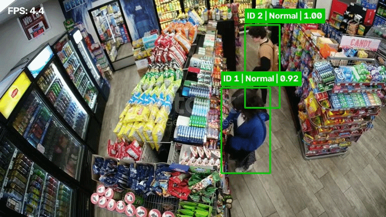
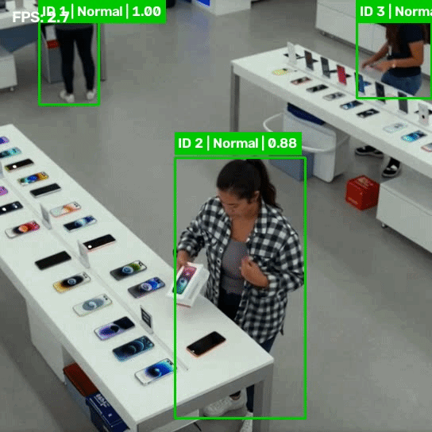
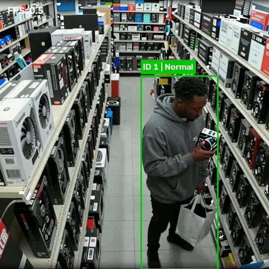
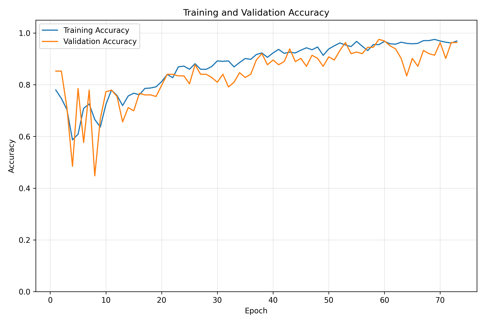
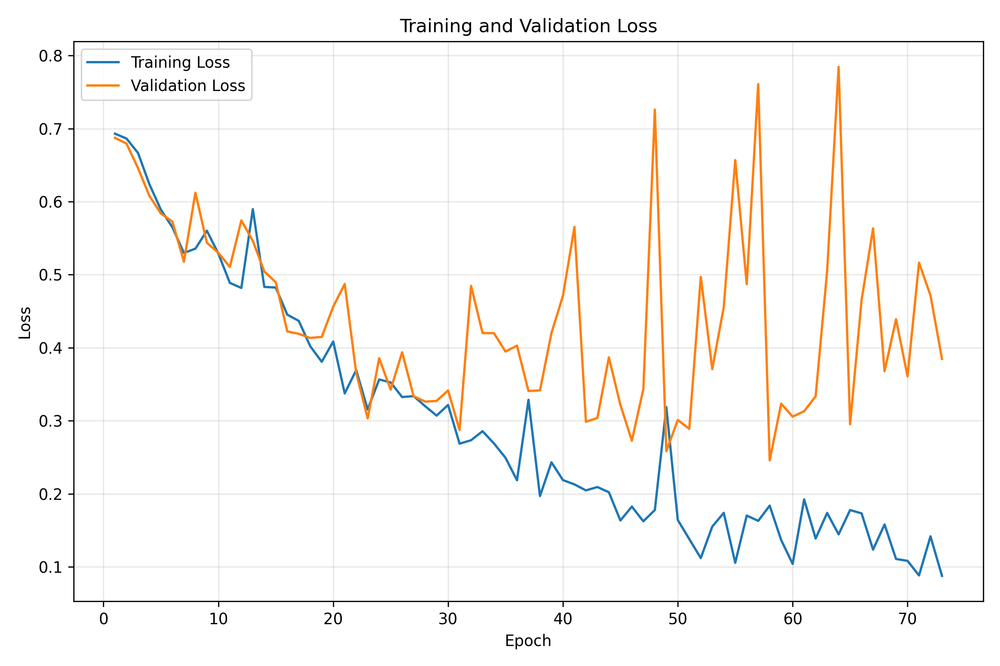
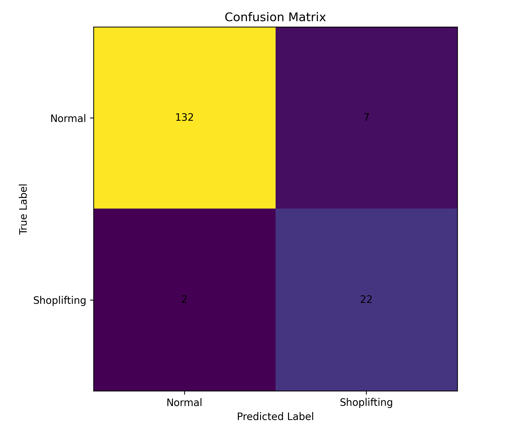

# Shoplifting Detection

> **YOLO Pose + ByteTrack + LSTM Behavior Recognition** — Track people in retail video and classify temporal behavior as Normal or Shoplifting.

     

This project uses **YOLO11 Pose** for human pose estimation, **ByteTrack** for stable person IDs, and a temporal **LSTM classifier** to distinguish between Normal and Shoplifting behavior from retail surveillance video.

Instead of classifying a single frame, the system follows each detected person over time, extracts body keypoints, builds pose sequences, and classifies the temporal movement pattern.

---

## 🎬 Demo

**Demo 1**



**Demo 2**



**Demo 3**



---

## ✨ Features

| Feature | Description |
|---|---|
| **Person Detection** | YOLO11 Pose detects people and estimates 17 COCO body keypoints |
| **Multi-Person Tracking** | ByteTrack keeps a stable ID for each person across video frames |
| **Pose Extraction** | Each tracked person is cropped and processed again with YOLO Pose |
| **Normalized Keypoints** | 17 body keypoints are converted to 34 normalized `(x, y)` features |
| **Temporal Classification** | An LSTM analyzes pose sequences instead of isolated frames |
| **Normal / Shoplifting Classification** | Each tracked person is classified into one of the two behavior classes |
| **Dataset Labeling Tool** | A Tkinter interface is used to create and label Normal and Shoplifting video segments |
| **Evaluation Metrics** | Training generates accuracy/loss curves, confusion matrix, and classification report |

---

## 📊 Results

The training script saves the main evaluation outputs inside:

```text
pose_dataset/training_results/
```

**Training and Validation Accuracy**



**Training and Validation Loss**



**Confusion Matrix**



**Classification Report**

The final classification report contains:

```text
              precision    recall  f1-score   support

Normal
Shoplifting

accuracy
macro avg
weighted avg
```

The complete report is saved in:

```text
pose_dataset/training_results/metrics_summary.txt
```

---

## 🗂️ Dataset

The current experimental dataset was created from **9 source videos** containing Normal and Shoplifting scenarios.

The dataset creation workflow is:

1. Open a source video in the labeling application
2. Detect and track people with YOLO11 Pose + ByteTrack
3. Treat detected people as **Normal by default**
4. Manually mark the target tracked person as **Shoplifting** when required
5. Save labeled video segments and tracking annotations
6. Extract pose features from each tracked person
7. Build temporal sequences for LSTM training

The two classes are:

| Class ID | Class |
|---:|---|
| 0 | Normal |
| 1 | Shoplifting |

The pose representation uses the **17 COCO body keypoints**:

```text
17 keypoints × 2 coordinates = 34 pose features
```

Low-confidence or missing keypoints are represented by zeros.

---

## 🏗️ Architecture

```text
Retail Video
    │
    ▼
YOLO11 Pose
    │
    ▼
ByteTrack
    │
    ▼
Tracked Person Bounding Box
    │
    ▼
8% Padded Person Crop
    │
    ▼
YOLO11 Pose on Person Crop
    │
    ▼
17 COCO Keypoints
    │
    ▼
34 Normalized Pose Features
    │
    ▼
Temporal Pose Sequence
    │
    ▼
2-Layer LSTM
Hidden Size: 128
    │
    ▼
Linear 128 → 64
    │
    ▼
ReLU + Dropout
    │
    ▼
Linear 64 → 2
    │
    ▼
Normal / Shoplifting
```

---

## 📁 Project Structure

```text
Shoplifting_Detection/
├── README.md
├── requirements.txt
├── .gitignore
│
├── src/
│   ├── 01_dataset_labeling_gui.py
│   ├── 02_extract_pose_sequences.py
│   ├── 03_train_lstm.py
│   └── 04_inference_lstm.py
│
├── dataset/
│   ├── Normal/
│   └── Shoplifting/
│
├── pose_dataset/
│   ├── X.npy
│   ├── y.npy
│   ├── shoplifting_lstm.pt
│   └── training_results/
│       ├── accuracy_curve.png
│       ├── loss_curve.png
│       ├── confusion_matrix.png
│       └── metrics_summary.txt
│
├── assets/
│   └── gifs/
│       ├── demo_1.gif
│       ├── demo_2.gif
│       └── demo_3.gif
│
└── docs/
    └── RESULTS.md
```

---

## 🚀 Getting Started

### Prerequisites

- Python 3.10+
- PyTorch
- OpenCV
- Ultralytics
- YOLO11 Pose weights: `yolo11s-pose.pt`

### Installation

```bash
# 1. Clone the repository
git clone https://github.com/Wassimhfaiedh/Shoplifting_Detection.git
cd Shoplifting_Detection

# 2. Create and activate a virtual environment
python -m venv .venv
source .venv/bin/activate        # Linux/macOS
.venv\Scripts\activate           # Windows

# 3. Install dependencies
pip install -r requirements.txt
```

---

## 📋 Requirements

```text
ultralytics
opencv-python
numpy
torch
torchvision
scikit-learn
matplotlib
Pillow
```

---

## 🖥️ Usage

### 1. Create and label the dataset

```bash
python src/01_dataset_labeling_gui.py
```

The labeling interface uses YOLO11 Pose + ByteTrack to track people in each source video.

Detected persons are Normal by default, and the relevant tracked person can be manually marked as Shoplifting.

---

### 2. Extract pose sequences

```bash
python src/02_extract_pose_sequences.py
```

The script:

- reads the labeled video segments,
- retrieves each tracked person bounding box,
- applies an 8% padding around the person,
- runs YOLO Pose on the person crop,
- extracts 17 body keypoints,
- normalizes `(x, y)` coordinates,
- generates temporal pose sequences,
- saves the final arrays as `X.npy` and `y.npy`.

---

### 3. Train the LSTM

```bash
python src/03_train_lstm.py
```

Training configuration:

| Parameter | Value |
|---|---:|
| Batch size | 16 |
| Maximum epochs | 150 |
| Learning rate | 0.001 |
| Hidden size | 128 |
| LSTM layers | 2 |
| Dropout | 0.40 |
| Validation split | 20% |
| Early stopping patience | 15 |

The training script automatically saves:

```text
accuracy_curve.png
loss_curve.png
confusion_matrix.png
metrics_summary.txt
```

---

### 4. Run inference

```bash
python src/04_inference_lstm.py
```

The inference pipeline is:

```text
Video Frame
→ YOLO11 Pose + ByteTrack
→ Person ID
→ Person Crop
→ Pose Extraction
→ Pose History
→ LSTM
→ Temporal Smoothing
→ Normal / Shoplifting
```

The output video displays each tracked person with:

```text
ID X | Normal
```

or:

```text
ID X | Shoplifting
```

---

## ⚙️ Main Configuration

Important parameters can be adjusted directly in the scripts:

```python
POSE_MODEL_PATH = "yolo11s-pose.pt"

TRACKER = "bytetrack.yaml"

POSE_CONF_THRESHOLD = 0.50
KEYPOINT_CONF_THRESHOLD = 0.50

HIDDEN_SIZE = 128
NUM_LAYERS = 2
DROPOUT = 0.40
```

---

## 📈 Evaluation

The project focuses on the following evaluation outputs:

- **Training / Validation Accuracy**
- **Training / Validation Loss**
- **Confusion Matrix**
- **Classification Report**
  - Precision
  - Recall
  - F1-score
  - Support

These results are generated automatically during training and stored under:

```text
pose_dataset/training_results/
```

---

## ⚠️ Limitations

- Similar hand/body movements can sometimes produce false positives
- Weak or occluded pose keypoints can affect temporal classification
- Performance depends strongly on camera angle and dataset diversity
- The current dataset contains only 9 source videos
- Pose-only classification does not explicitly model interaction with products

---

## 🔭 Future Improvements

- Add more independent Normal and Shoplifting videos
- Add more hard-negative Normal examples
- Improve pose robustness under occlusion
- Add hand-to-object interaction features
- Add pose velocity features
- Experiment with temporal attention
- Use grouped train/validation splitting by source video
- Optimize the decision threshold for precision/recall balance

---

## 🙏 Acknowledgements

- [Ultralytics](https://github.com/ultralytics/ultralytics) — YOLO11 Pose
- [ByteTrack](https://github.com/ifzhang/ByteTrack) — multi-object tracking
- [PyTorch](https://pytorch.org/) — LSTM training and inference
- [OpenCV](https://opencv.org/) — video processing

---

## 📝 License

This project is licensed under the MIT License. See [LICENSE](LICENSE) for details.
