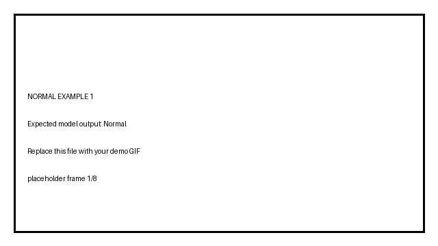
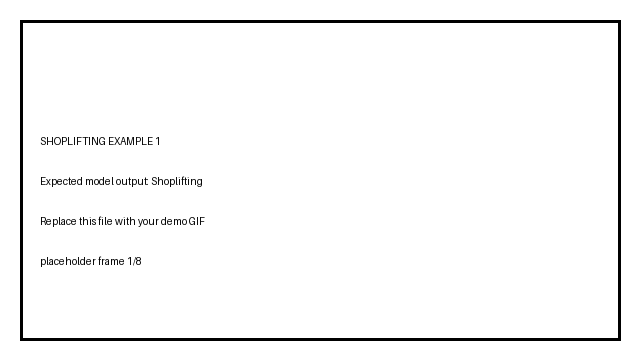

# Shoplifting Detection with YOLO Pose, ByteTrack and LSTM

A computer-vision pipeline for **person tracking and temporal shoplifting-behavior classification** from retail video.

The project combines **YOLO11 Pose** for human pose estimation, **ByteTrack** for persistent person IDs, and an **LSTM classifier** that learns motion patterns across short pose sequences.

---

## Demo

### Normal examples

| Normal example 1 | Normal example 2 |
|---|---|
|  |  |

### Shoplifting examples

| Shoplifting example 1 | Shoplifting example 2 |
|---|---|
|  |  |

Replace the four placeholder GIFs in `assets/gifs/` while keeping the same filenames.

---

## Project overview

The system is designed as a temporal pose-classification pipeline rather than a single-frame image classifier.

```text
Retail video
    │
    ▼
YOLO11 Pose
    │
    ▼
ByteTrack person tracking
    │
    ▼
Tracked person bounding box
    │
    ├── 8% padded person crop
    │
    ▼
YOLO11 Pose on person crop
    │
    ▼
17 COCO keypoints
    │
    ▼
34 normalized pose features
(x1, y1, ... x17, y17)
    │
    ▼
Temporal pose sequence
    │
    ▼
2-layer LSTM
    │
    ▼
Normal / Shoplifting
```

### Why pose + LSTM?

A single frame does not describe a behavior well. Shoplifting is a temporal action, so the system tracks body motion over a sequence of observations. The LSTM receives normalized body-joint coordinates and learns the difference between normal customer movement and labeled shoplifting behavior.

---

## Dataset

The current dataset was created from **9 source videos**.

The workflow is:

1. Open a source video in the labeling application.
2. Detect and track people with YOLO Pose + ByteTrack.
3. Treat every detected person as **Normal by default**.
4. Manually mark the relevant tracked ID as **Shoplifting** when required.
5. Save labeled video segments and tracking annotations.
6. Convert the labeled tracks into pose sequences.
7. Train the LSTM on the resulting `X.npy` and `y.npy`.

### Classes

| Class ID | Class |
|---:|---|
| 0 | Normal |
| 1 | Shoplifting |

The pose representation uses the **17 COCO body keypoints**, with normalized `(x, y)` coordinates for each point:

```text
17 keypoints × 2 coordinates = 34 features per pose observation
```

Low-confidence or missing keypoints are represented by zeros.

> The repository structure is prepared for the dataset, but source videos and generated clips are excluded by `.gitignore` to keep the GitHub repository lightweight.

---

## Repository structure

```text
shoplifting_detection_yolo_pose_lstm/
│
├── README.md
├── requirements.txt
├── .gitignore
│
├── src/
│   ├── 01_dataset_labeling_gui.py
│   ├── 02_extract_pose_sequences.py
│   ├── 03_train_lstm.py
│   └── 04_inference_lstm.py
│
├── dataset/
│   ├── README.md
│   ├── Normal/
│   │   └── .gitkeep
│   └── Shoplifting/
│       └── .gitkeep
│
├── pose_dataset/
│   ├── README.md
│   └── training_results/
│       └── .gitkeep
│
├── assets/
│   └── gifs/
│       ├── normal_1.gif
│       ├── normal_2.gif
│       ├── shoplifting_1.gif
│       └── shoplifting_2.gif
│
└── docs/
    └── RESULTS.md
```

---

## Pipeline details

### 1. Dataset labeling GUI

Run:

```bash
python src/01_dataset_labeling_gui.py
```

The GUI uses YOLO11 Pose and ByteTrack to track people in the selected video. Detected people are Normal by default, and selected track IDs can be marked as Shoplifting.

Generated data is organized under:

```text
dataset/
├── Normal/
└── Shoplifting/
```

---

### 2. Pose-sequence extraction

Run:

```bash
python src/02_extract_pose_sequences.py
```

For each tracked person:

- the bounding box is clipped to the source frame,
- an **8% padding** is applied,
- YOLO Pose is run on the person crop,
- the highest-confidence person pose is selected,
- 17 keypoints are converted to 34 normalized `(x, y)` features,
- temporal windows are generated for LSTM training.

The current extraction script contains configurable temporal settings near the top of the file. In the supplied version, these are:

```python
SEQUENCE_LENGTH = 10
SEQUENCE_STRIDE = 5
```

The generated training arrays are stored in:

```text
pose_dataset/
├── X.npy
└── y.npy
```

---

### 3. LSTM training

Run:

```bash
python src/03_train_lstm.py
```

The supplied model uses:

```text
Input pose sequence
      │
      ▼
2-layer LSTM
Hidden size: 128
      │
      ▼
Last temporal representation
      │
      ▼
Dropout
      │
      ▼
Linear 128 → 64
      │
      ▼
ReLU
      │
      ▼
Dropout
      │
      ▼
Linear 64 → 2
      │
      ▼
Normal / Shoplifting
```

Training configuration:

| Parameter | Value |
|---|---:|
| Batch size | 16 |
| Maximum epochs | 150 |
| Learning rate | 0.001 |
| Hidden size | 128 |
| LSTM layers | 2 |
| Dropout | 0.40 |
| Validation split | 20% |
| Early-stopping patience | 15 |

Class-weighted cross-entropy is used to reduce the effect of class imbalance.

---

## Results and evaluation

The training script automatically saves evaluation artifacts under:

```text
pose_dataset/training_results/
```

### Generated plots

| Artifact | Description |
|---|---|
| `loss_curve.png` | Training and validation loss |
| `accuracy_curve.png` | Training and validation accuracy |
| `precision_recall_f1_curve.png` | Validation precision, recall and F1 across epochs |
| `confusion_matrix.png` | Final Normal vs Shoplifting confusion matrix |
| `roc_curve.png` | ROC curve and ROC-AUC |
| `precision_recall_curve.png` | Precision-recall curve and Average Precision |

### Generated metric files

```text
training_history.csv
final_metrics.csv
metrics_summary.txt
```

The summary includes:

- Accuracy
- Precision
- Recall
- F1-score
- ROC-AUC
- Average Precision
- Best validation loss
- Best validation accuracy

### Measured results

Populate this table after your final training run using `pose_dataset/training_results/metrics_summary.txt`:

| Metric | Result |
|---|---:|
| Accuracy | `TBD` |
| Precision — Shoplifting | `TBD` |
| Recall — Shoplifting | `TBD` |
| F1-score — Shoplifting | `TBD` |
| ROC-AUC | `TBD` |
| Average Precision | `TBD` |

> The numerical values are left as `TBD` because no completed metric output was supplied in this project package. This avoids publishing invented results.

---

## Inference

Run:

```bash
python src/04_inference_lstm.py
```

The inference stage performs:

```text
video frame
→ YOLO Pose + ByteTrack
→ person ID
→ padded person crop
→ normalized pose
→ pose history
→ LSTM
→ probability smoothing
→ Normal / Shoplifting
```

The current inference script loads:

```text
pose_dataset/shoplifting_lstm.pt
```

and produces an annotated output video.

The decision threshold and temporal smoothing are configurable at the top of `src/04_inference_lstm.py`.

---

## Installation

### 1. Clone the repository

```bash
git clone https://github.com/YOUR_USERNAME/shoplifting_detection_yolo_pose_lstm.git
cd shoplifting_detection_yolo_pose_lstm
```

### 2. Create a virtual environment

Windows:

```bash
python -m venv .venv
.venv\Scripts\activate
```

Linux/macOS:

```bash
python3 -m venv .venv
source .venv/bin/activate
```

### 3. Install dependencies

```bash
pip install -r requirements.txt
```

YOLO weights such as `yolo11s-pose.pt` can be placed in the project root or resolved by Ultralytics when supported by the installed package.

---

## Typical workflow

```bash
# 1. Label the source videos
python src/01_dataset_labeling_gui.py

# 2. Build pose sequences
python src/02_extract_pose_sequences.py

# 3. Train and save metrics
python src/03_train_lstm.py

# 4. Run inference
python src/04_inference_lstm.py
```

---

## Notes on validation

The current training script uses a stratified random train/validation split of the generated pose sequences.

For a stronger final benchmark, especially when neighboring temporal windows come from the same source footage, use a **video-level or segment-level grouped split** so sequences from the same source do not appear in both training and validation.

This is especially important when reporting final GitHub metrics.

---

## Limitations

- The system learns behavior from body pose, so visually similar hand/body movements can produce false positives.
- Occlusion or weak keypoint estimates can reduce classification quality.
- Dataset diversity strongly affects generalization to new stores, cameras and viewpoints.
- Pose-only behavior classification does not explicitly model product-object interaction.
- The current dataset contains 9 source videos, so additional independent scenes are recommended before treating the model as production-ready.

---

## Future improvements

Possible next steps include:

- more independent training videos,
- hard-negative examples,
- hand-to-object interaction features,
- temporal attention,
- pose velocity features,
- grouped train/validation splits,
- per-camera calibration,
- threshold tuning based on the precision-recall curve.

---

## Technologies

- Python
- PyTorch
- Ultralytics YOLO11 Pose
- ByteTrack
- OpenCV
- NumPy
- scikit-learn
- Matplotlib
- Tkinter
- Pillow

---

